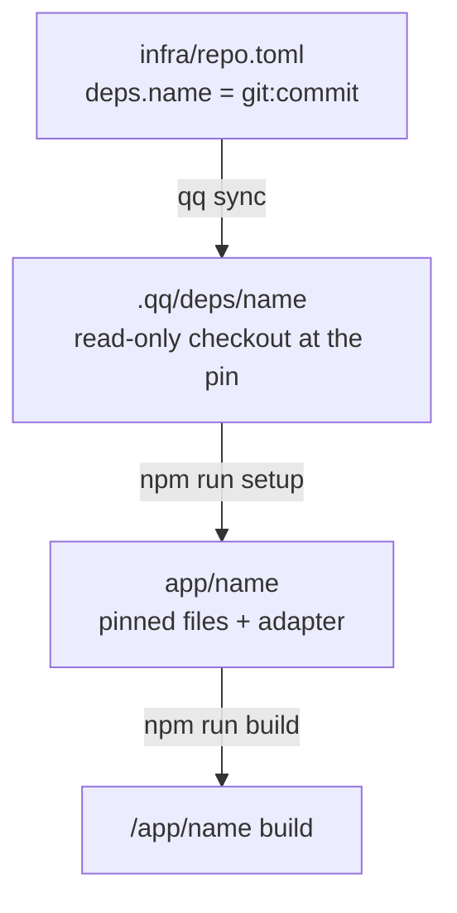

# Maintaining Euler's app sources

Euler does not carry the sources of Innernet, Quitter, and Instants. Each app keeps
its own repository, and Euler pins one commit of it in
[`infra/repo.toml`](../infra/repo.toml), read through qq's `sync`:

| App | Repository | Euler's adapter |
| --- | --- | --- |
| Innernet | [quirq-ai/innernet](https://github.com/quirq-ai/innernet) | [`app/adapters/innernet.patch`](../app/adapters/innernet.patch) |
| Quitter | [quirq-ai/quitter](https://github.com/quirq-ai/quitter) | [`app/adapters/quitter.patch`](../app/adapters/quitter.patch) |
| Instants | [quirq-ai/instants](https://github.com/quirq-ai/instants) | [`app/adapters/instants.patch`](../app/adapters/instants.patch) |

The adapter holds the only changes Euler makes to an app: what it needs to run
under `/app/<name>` (its base path and build directory) and the cross-platform
development scripts. Each app's Nx `project.json` stays tracked in Euler.

## How an app gets into `app/`



1. `qq sync` (or `qq fetch`, which clones and then syncs) fetches each pin once per
   machine into qq's store, checks it against its commit, and links it at
   `.qq/deps/<name>`. The store copy is read only.
2. `npm run setup` copies the files tracked at that commit into `app/<name>`,
   applies the adapter with `git apply`, and installs the app from its lockfile. It
   records what it wrote in `app/<name>/.euler-source.json`.
3. When the pin or the adapter changes, the next setup removes the files it wrote
   before and writes the new ones. Files it did not write stay: local indexes,
   journals, `.env` files, dependencies, and builds. If a file it would write is
   already there and it did not write it, setup stops and names it, so nothing of
   yours is replaced.

Edits made by hand inside `app/<name>` are replaced on the next pin or adapter
change. Make app changes in the app's own repository, or in its adapter.

## Move an app to a newer commit

Commit your local Euler changes first. Then, from the Euler repository root:

```sh
qqsync pin deps innernet --digest git:<commit>
qq sync
npm run setup -- innernet
npm run build -- --app innernet
npm test
```

`qqsync` is installed with qq (see the [qq guide](https://docs.quirq.dev/docs/qq)).
Stop Euler before rebuilding an app it is serving. Start Euler again with
`npm start`, open the app, and check its pages, assets, and API behavior under
`/app/innernet`. Replace `innernet` with `quitter` or `instants` as needed.

If setup reports that the adapter does not apply, the new commit changed lines
the adapter touches. Regenerate the adapter against the new commit: copy the
prepared `app/<name>` into a checkout of the app at that commit, fix the
conflicting lines, and save `git diff` there as `app/adapters/<name>.patch`. Then
run setup again. Commit the pin and the adapter together.

Running `git pull` in Euler brings the pins and adapters others have published;
run `qq sync` and `npm run setup` after it.

## Upgrade from the `apps/` folder

Older Euler checkouts kept the sources in `apps/`. Stop Euler and any standalone
app servers, commit the source changes you want to keep, and back up your local
app data. Then run from the Euler repository root:

```sh
git pull --ff-only
qq sync
npm ci
npm run setup
npm run migrate:app-data
npm run build
npm start
```

The migration command moves local app data left in the old `apps/<name>`
directories to matching paths under `app/<name>`. It preserves local environment
files, Innernet indexes, Instants journals, and other files that are not
generated. Before moving any files, it checks all destinations and refuses
collisions, unknown old app directories, and data symlinks or junctions. It skips
generated dependencies and build output; setup and build recreate those in the new
paths. Use `npm run migrate:app-data -- --dry-run` to preview the migration. Fresh
clones and repeated migrations have nothing to move. Existing `.workspace-state`
settings and browser preferences keep their locations.

If the command reports a collision, compare and back up both copies before
resolving it and rerunning the command. The helper does not overwrite either copy
or remove the old directory; skipped generated artifacts remain there. Update any
custom manifests, editor tasks, and external scripts from `apps/<name>` to
`app/<name>`. Hosting projects deploy each app from its own repository
([Vercel](../README.md#vercel-individual-apps)).

Local indexes, journals, and browser preferences are separate from the app
sources. Continue to back them up as described in
[Data and settings](../README.md#data-and-settings).
